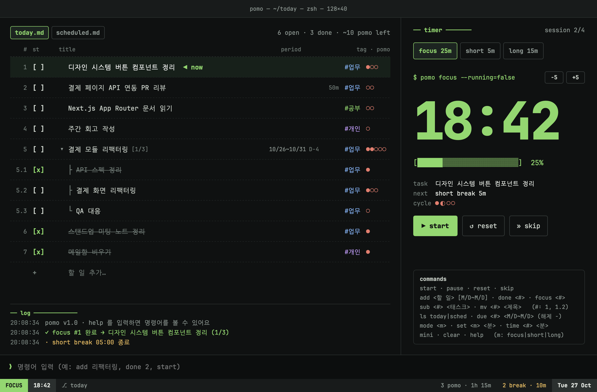
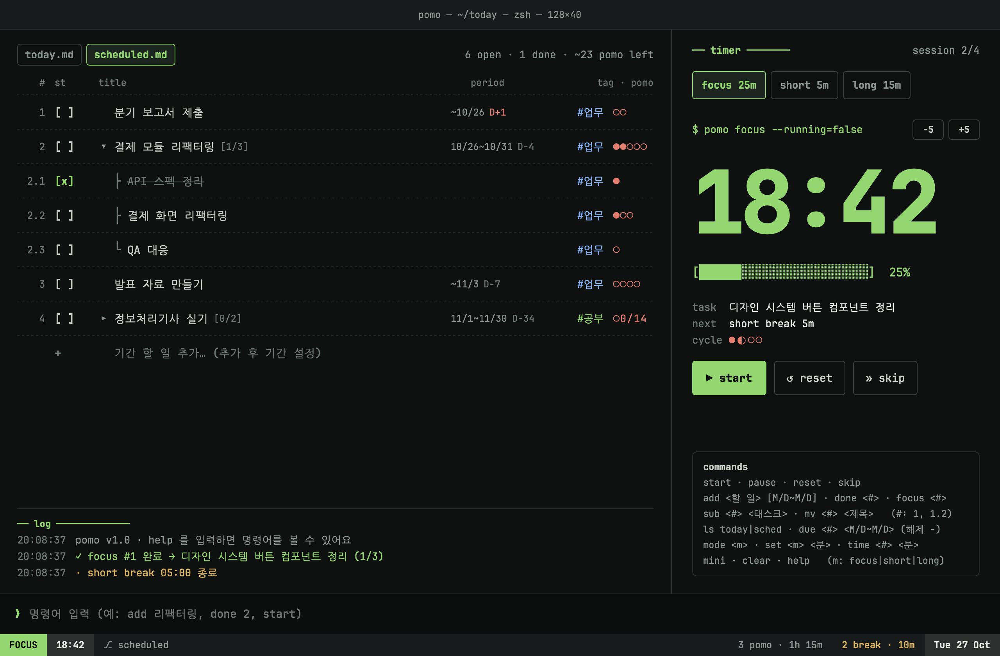
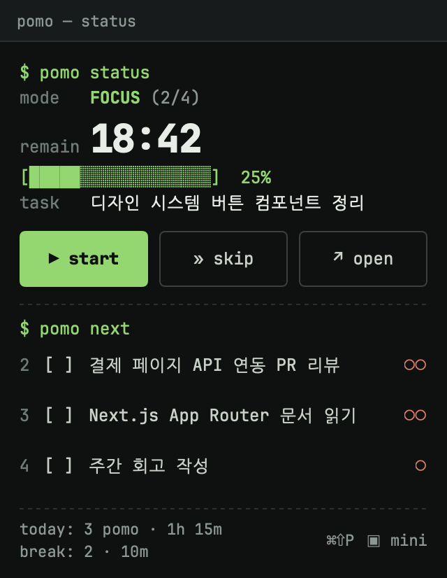
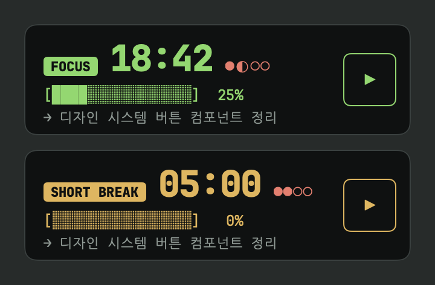
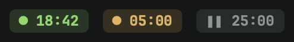

# pomo-term

터미널 감성의 macOS 뽀모도로 + 할 일 관리 앱.
SwiftUI로 만든 네이티브 앱이고, 마우스로도 명령어(`❯ add 리팩터링`, `done 2`, `start`)로도 쓸 수 있어요.



## 기능

- **뽀모도로 타이머**: 집중 25분 · 짧은 휴식 5분 · 긴 휴식 15분(4회마다). 메인 창에서 −/+로 바로 조절
- **할 일 목록**: `today.md` / `scheduled.md` 두 탭
  - 오늘 할 일과, 시작일~마감일이 있는 기간 할 일을 나눠 관리 (D-day 표시)
  - **스토리 > 태스크** 두 단계 하위 작업, 접기/펼치기, 진행률 `[1/3]`
  - 태그(#업무 #개인 #공부), 예상 뽀모도로, 할 일마다 다른 집중 시간
- **기록**: 오늘 완료한 뽀모도로 수 · 집중 시간 · 휴식 횟수 · 휴식 시간
- **메뉴 막대**: 남은 시간을 `● 18:42`로 표시, 팝오버에서 시작/건너뛰기/다음 할 일
- **미니 타이머**: 항상 위에 떠 있는 작은 창
- **전역 단축키**: 어느 앱에서든 ⌘⇧P로 시작/일시정지 (설정에서 끌 수 있음)
- 완료 알림과 소리, 데이터 자동 저장

| 기간 할 일 · 스토리 > 태스크 | 마우스 오버 버튼 · 바로 추가 |
|---|---|
|  |  |

| 메뉴 막대 팝오버 | 미니 타이머 · 메뉴 막대 라벨 |
|---|---|
|  | <br> |

## 요구 사항

- macOS 14 (Sonoma) 이상, Apple Silicon
- Command Line Tools for Xcode (`xcode-select --install`). Xcode 앱은 없어도 빌드돼요

## 빌드 · 실행

```bash
git clone https://github.com/suyeon9456/pomo-term.git
cd pomo-term
./build.sh
open build/PomodoroTodo.app
```

`build.sh`는 Command Line Tools의 `swiftc`로 컴파일한 뒤 `.app` 번들(Info.plist, 폰트 포함)을 만들고 ad-hoc 서명까지 해요.
계속 쓰려면 `build/PomodoroTodo.app`을 응용 프로그램 폴더로 옮기면 돼요.

## 사용법

### 마우스로

| 하고 싶은 것 | 방법 |
|---|---|
| 할 일 추가 | 목록 맨 아래 `+ 할 일 추가…` (⌘N) |
| 하위 태스크 추가 | 스토리에 마우스를 올리고 `[+ sub]` |
| 집중 대상 선택 | 제목 클릭 |
| 완료 | `[ ]` 클릭 (열린 태스크가 있는 스토리는 함께 완료할지 물어봄) |
| 제목 수정 | 제목 더블클릭 |
| 기간 · 태그 · 집중 시간 · 삭제 | 우클릭 또는 `[⋯]` |
| 접기 / 펼치기 | 스토리 앞 `▾` / `▸` |

### 명령어

창 아래 `❯` 입력줄에 입력하고 Enter. `<#>`는 목록 번호로, 하위 태스크는 `1.2`처럼 써요.

| 명령어 | 별칭 | 설명 |
|---|---|---|
| `start` · `pause` · `reset` · `skip` | `s` `p` `r` | 타이머 시작 · 일시정지 · 초기화 · 다음 단계로 |
| `add <할 일> [기간]` | `a` | 할 일 추가. 예: `add 발표 자료 ~11/3` |
| `sub <#> <태스크> [기간]` | | 스토리 아래 태스크 추가 |
| `mv <#> <새 제목>` | | 제목 수정 |
| `done <#> [--all\|--only]` | `d` | 완료 토글. 열린 태스크가 있는 스토리는 `--all`(함께 완료) / `--only`(스토리만) |
| `focus <#>` | `f` | 집중 대상 선택 (번호 없이 쓰면 focus 모드로) |
| `fold <#>` · `unfold <#>` | | 스토리 접기 · 펼치기 |
| `ls today\|sched` | | 탭 전환 |
| `due <#> <기간>` · `due <#> -` | | 기간 설정 · 해제 |
| `time <#> <분>` · `time <#> -` | `t` | 할 일의 집중 시간 설정 · 기본값으로 |
| `mode focus\|short\|long` | | 모드 전환 |
| `set focus\|short\|long <분>` | | 기본 시간 변경 |
| `mini` | `m` | 미니 타이머 열기/닫기 |
| `clear` · `help` | | 로그 비우기 · 명령어 목록 |

기간은 `11/3`, `~11/3`(마감일만), `10/27~10/31`, `오늘~내일` 형식이에요.
연도는 쓰지 않고, 마감일이 지난 날짜면 내년으로 봐요.

### 목록 규칙

- **today**: 기간 없는 할 일 + 시작일이 오늘이거나 지난 기간 할 일
- **scheduled**: 기간 할 일 전체, 마감일 순 (마감일만 있는 할 일은 여기에만)
- 완료한 할 일은 완료한 날까지만 보이고, 미완료는 다음 날로 이어져요
- 뽀모도로 · 휴식은 끝까지 마친 것만 기록하고 skip한 건 세지 않아요

### 단축키

| 단축키 | 동작 |
|---|---|
| ⌘N | 새 할 일 |
| ⌘1 / ⌘2 | today / scheduled 탭 |
| ⌘⇧M | 미니 타이머 |
| ⌘⇧P | 어디서든 시작/일시정지 (전역, VS Code 명령 팔레트와 겹치면 설정에서 끄기) |
| ⌘, | 설정 |

## 데이터

할 일과 설정, 오늘 기록은 아래 파일 하나에 자동 저장돼요.

```
~/Library/Application Support/PomodoroTodo/data.json
```

## 프로젝트 구조

```
Sources/
├── PomodoroTodoApp.swift   앱 시작점 (메인 창, 메뉴 막대, 설정, 메뉴 명령)
├── AppStore.swift          상태 · 타이머 · 할 일 · 명령어 해석 · 저장
├── Models.swift            TodoItem, ListRow, 설정, 저장 형식
├── Period.swift            기간 해석과 D-day
├── Theme.swift             색 토큰, 번들 폰트
├── MainWindowView.swift    메인 창
├── MenuBarPopover.swift    메뉴 막대 라벨과 팝오버
├── MiniTimer.swift         미니 타이머 (NSPanel)
├── GlobalHotKey.swift      ⌘⇧P 전역 단축키
├── SettingsView.swift      설정 창
└── Snapshot.swift          개발용 화면 스냅샷
Resources/Fonts/            JetBrains Mono, Nanum Gothic Coding
```

화면을 PNG로 뽑아 보려면 (샘플 데이터 사용, `data.json`은 건드리지 않음):

```bash
build/PomodoroTodo.app/Contents/MacOS/PomodoroTodo --snapshot ./snapshots
```

## 폰트 라이선스

[JetBrains Mono](https://github.com/JetBrains/JetBrainsMono)와 [Nanum Gothic Coding](https://github.com/google/fonts/tree/main/ofl/nanumgothiccoding)은 SIL Open Font License 1.1을 따르며, 라이선스 전문은 `Resources/Fonts/`에 함께 들어 있어요.
